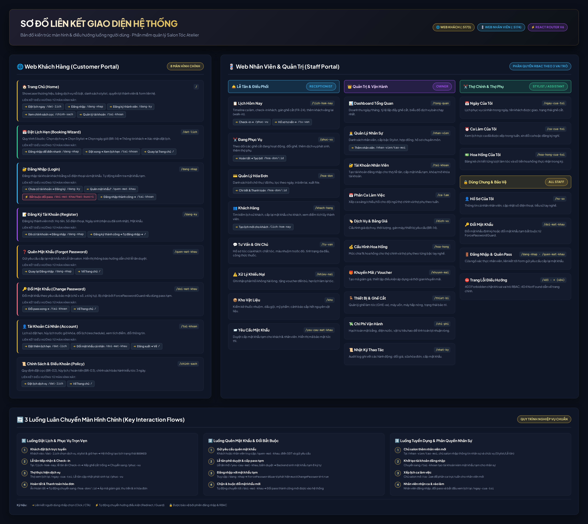
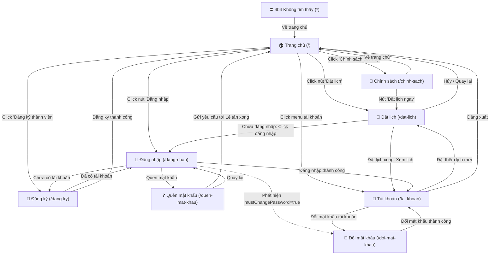

# Sơ đồ Liên Kết Giao Diện (Screen Flow & Navigation Architecture)

> **Dự án:** Hệ thống phần mềm quản lý Salon Tóc Atelier (SE100)  
> **Kiến trúc:** Micro-frontend gồm 2 ứng dụng web độc lập:
> - **Web Khách Hàng (`web-customer`)**: Cổng `5173`
> - **Web Nhân Viên & Quản Trị (`web-staff`)**: Cổng `5174`

---

## 1. Sơ đồ trực quan (Dạng hình ảnh)

Sơ đồ tổng quan toàn bộ các màn hình, liên kết điều hướng và luồng luân chuyển nghiệp vụ được kết xuất trực tiếp dưới dạng hình ảnh độ phân giải cao:

* File ảnh gốc chất lượng cao: [`docs/lien-ket-giao-dien.png`](./lien-ket-giao-dien.png) (Độ phân giải 5120 × 4566 px)
* File giao diện tương tác độc lập (HTML): [`docs/lien-ket-giao-dien.html`](./lien-ket-giao-dien.html) (Mở trực tiếp trên trình duyệt)

---

## 2. Sơ đồ cấu trúc luồng (Mermaid Flowchart)

### 2.1. Web Khách Hàng (Customer Portal — Cổng 5173)

---

### 2.2. Web Nhân Viên & Quản Trị (Staff Portal — Cổng 5174)

```mermaid
flowchart TD
    %% Xác thực chung
    StaffLogin["🔐 Đăng nhập (/dang-nhap)"]
    StaffForgot["❓ Quên mật khẩu (/quen-mat-khau)"]
    StaffChange["🔑 Đổi mật khẩu (/doi-mat-khau)"]
    StaffProfile["👤 Hồ sơ cá nhân (/ho-so)"]
    Error403["⛔ 403 Forbidden (/403)"]
    Error404["⛔ 404 Not Found (*)"]

    %% Cổng vào
    StaffLogin -->|Quên mật khẩu| StaffForgot
    StaffForgot -->|Quay lại| StaffLogin
    StaffLogin -.->|Tài khoản dùng mật khẩu tạm: Chặn bắt buộc| StaffChange
    StaffProfile -->|Đổi mật khẩu| StaffChange

    %% Phân quyền sau đăng nhập
    StaffLogin ==>|Vai trò: OWNER| OwnerDash["📊 Tổng quan (/tong-quan)"]
    StaffLogin ==>|Vai trò: RECEPTIONIST| TodayBoard["📋 Lịch hôm nay (/lich-hom-nay)"]
    StaffLogin ==>|Vai trò: STYLIST / ASSISTANT| MyDay["📅 Ngày của tôi (/ngay-cua-toi)"]

    %% Nhóm Lễ tân (DESK: Receptionist & Owner)
    subgraph DESK ["🛎️ Phân hệ Lễ tân & Điều hành"]
        TodayBoard -->|Check-in khách vào ghế| Sessions["✂️ Đang phục vụ (/phuc-vu)"]
        Sessions -->|Hoàn tất dịch vụ: Tạo bill| InvoiceDetail["🧾 Chi tiết & Thu tiền (/hoa-don/:id)"]
        Invoices["💳 Danh sách Hóa đơn (/hoa-don)"] --> InvoiceDetail
        InvoiceDetail -->|Thanh toán xong| Invoices
        Customers["👥 Quản lý Khách hàng (/khach-hang)"] -->|Tạo lịch hẹn mới| TodayBoard
        Consultations["💬 Hồ sơ Tư vấn tóc (/tu-van)"]
        Complaints["⚠️ Xử lý Khiếu nại (/khieu-nai)"]
        Inventory["📦 Kho vật liệu (/kho)"]
        PassReqs["📨 Yêu cầu Mật khẩu (/yeu-cau-mat-khau)"]
    end

    %% Nhóm Chủ salon (OWNER Only)
    subgraph OWNER_GRP ["👑 Phân hệ Chủ salon (Quản trị toàn quyền)"]
        OwnerDash
        Employees["👨‍💼 Quản lý Nhân sự (/nhan-vien)"] -->|Thêm nhân sự mới| NewEmp["➕ Thêm nhân viên (/nhan-vien/tao-moi)"]
        NewEmp -->|Tạo xong: Cấp tài khoản| StaffAccounts["🔐 Tài khoản nhân viên (/tai-khoan)"]
        Shifts["📅 Phân ca làm việc (/ca-lam)"]
        Services["🏷️ Dịch vụ & Giá (/dich-vu)"]
        Commissions["💰 Cấu hình Hoa hồng (/hoa-hong)"]
        Promotions["🎁 Khuyến mãi / Voucher (/khuyen-mai)"]
        Equipment["🪑 Thiết bị & Ghế cắt (/thiet-bi)"]
        Expenses["💸 Chi phí vận hành (/chi-phi)"]
        AuditLog["📜 Nhật ký thao tác (/nhat-ky)"]
    end

    %% Nhóm Thợ làm tóc (CRAFT: Stylist & Assistant)
    subgraph CRAFT_GRP ["✂️ Phân hệ Thợ làm tóc & Thợ phụ"]
        MyDay -->|Xem hồ sơ lịch sử tóc khách| Consultations
        MyShifts["⏰ Ca làm việc cá nhân (/ca-cua-toi)"]
        MyCommission["💵 Bảng kê hoa hồng (/hoa-hong-cua-toi)"]
    end

    %% Bảo vệ Route
    StaffLogin -.->|Truy cập trang không có quyền| Error403
    StaffLogin -.->|Sai URL| Error404
```

---

## 3. Bảng Ma Trận Chi Tiết Mọi Màn Hình & Liên Kết Điều Hướng

### 3.1. Web Khách Hàng (`web-customer` — Cổng 5173)

| # | Tên màn hình | Đường dẫn | Quyền truy cập | Các màn hình liên kết tới | Tác nhân / Điều kiện kích hoạt |
|---|---|---|---|---|---|
| 1 | **Trang chủ** | `/` | Công khai | `/dat-lich` `/dang-nhap` `/dang-ky` `/tai-khoan` `/chinh-sach` | Nút "Đặt lịch" tại Header & Hero. Nút "Đăng nhập" tại Header. Nút "Đăng ký" tại banner thành viên. Menu tài khoản khi đã login. Link footer chính sách cọc/hủy. |
| 2 | **Đặt lịch** | `/dat-lich` | Công khai / Khách | `/dang-nhap` `/tai-khoan` `/` | Link "Đăng nhập để tự động điền". Nút "Xem lịch hẹn" sau khi đặt thành công. Nút hủy/quay về trang chủ. |
| 3 | **Đăng nhập** | `/dang-nhap` | Công khai | `/dang-ky` `/quen-mat-khau` `/doi-mat-khau` `/tai-khoan` | Link "Chưa có tài khoản? Đăng ký". Link "Quên mật khẩu?". Tự động chuyển nếu `mustChangePassword=true`. Đăng nhập thành công -> về Tài khoản. |
| 4 | **Đăng ký** | `/dang-ky` | Công khai | `/dang-nhap` `/` | Link "Đã có tài khoản? Đăng nhập". Đăng ký thành công -> tự đăng nhập -> về Trang chủ. |
| 5 | **Quên mật khẩu** | `/quen-mat-khau` | Công khai | `/dang-nhap` `/` | Link "Quay lại đăng nhập". Gửi yêu cầu tới lễ tân -> trở về Trang chủ. |
| 6 | **Đổi mật khẩu** | `/doi-mat-khau` | Đã đăng nhập (hoặc pass tạm) | `/tai-khoan` `/` | Đổi mật khẩu thành công -> chuyển về Trang tài khoản hoặc Trang chủ. |
| 7 | **Tài khoản cá nhân** | `/tai-khoan` | Khách thành viên | `/dat-lich` `/doi-mat-khau` `/` | Nút "Đặt thêm lịch hẹn". Link "Đổi mật khẩu cá nhân". Nút "Đăng xuất" -> về Trang chủ. |
| 8 | **Chính sách & Quy định** | `/chinh-sach` | Công khai | `/dat-lich` `/` | Nút "Đặt lịch ngay" ở cuối bài. Link quay về Trang chủ. |
| 9 | **Không tìm thấy** | `*` (404) | Công khai | `/` | Nút "Quay về trang chủ". |

---

### 3.2. Web Nhân Viên & Quản Trị (`web-staff` — Cổng 5174)

#### Nhóm Xác thực, Hồ sơ & Dùng chung
| # | Tên màn hình | Đường dẫn | Quyền truy cập (Role) | Liên kết chuyển hướng | Cơ chế kích hoạt |
|---|---|---|---|---|---|
| 1 | **Đăng nhập nhân viên** | `/dang-nhap` | Công khai | `/quen-mat-khau` `/doi-mat-khau` `/tong-quan` `/lich-hom-nay` `/ngay-cua-toi` | Link "Quên mật khẩu?". Chuyển hướng bắt buộc nếu dùng pass tạm. Chủ salon -> `/tong-quan`. Lễ tân -> `/lich-hom-nay`. Thợ tóc -> `/ngay-cua-toi`. |
| 2 | **Quên mật khẩu** | `/quen-mat-khau` | Công khai | `/dang-nhap` | Link "Quay lại trang đăng nhập". |
| 3 | **Đổi mật khẩu** | `/doi-mat-khau` | Mọi nhân viên | Trang chủ theo vai trò (`homeOf(role)`) | Sau khi đổi mật khẩu thành công. |
| 4 | **Hồ sơ của tôi** | `/ho-so` | Mọi nhân viên | `/doi-mat-khau` | Bấm từ menu Avatar trên Header. Có nút dẫn sang đổi mật khẩu. |
| 5 | **403 Forbidden** | `/403` | Mọi nhân viên | Trang chủ theo vai trò | Tự động chặn khi truy cập trang vượt quyền hạn (Guard). |
| 6 | **404 Not Found** | `*` | Mọi nhân viên | Trang chủ theo vai trò | Tự động kích hoạt khi URL không tồn tại. |

#### Nhóm Lễ tân & Điều hành bàn trực (`RECEPTIONIST` & `OWNER`)
| # | Tên màn hình | Đường dẫn | Chức năng chính | Liên kết chuyển tiếp |
|---|---|---|---|---|
| 7 | **Lịch hôm nay** | `/lich-hom-nay` | Xem timeline lịch hẹn, tiếp nhận khách, check-in gán ghế cắt (FR-24), thêm khách vãng lai (walk-in). | ➜ `/phuc-vu` (khi check-in) ➜ `/tu-van` (xem hồ sơ tóc khách) |
| 8 | **Đang phục vụ** | `/phuc-vu` | Quản lý trạng thái ghế cắt theo thời gian thực, đổi ghế, thêm thợ phụ, thêm dịch vụ phát sinh. | ➜ `/hoa-don/:id` (khi bấm Hoàn tất dịch vụ để lập hóa đơn) |
| 9 | **Quản lý hóa đơn** | `/hoa-don` | Danh sách hóa đơn, lọc theo trạng thái (chờ thu / đã thu), lọc ngày, thống kê tiền thu. | ➜ `/hoa-don/:id` (khi bấm vào một hóa đơn) |
| 10 | **Chi tiết & Thu tiền** | `/hoa-don/:id` | Áp mã voucher giảm giá, chọn phương thức thanh toán (Tiền mặt/Chuyển khoản/Thẻ), xác nhận thu tiền, in hóa đơn. | ➜ `/hoa-don` (sau khi thanh toán xong) |
| 11 | **Khách hàng** | `/khach-hang` | Danh bạ khách hàng, lịch sử làm tóc, điểm tích lũy, cấp lại mật khẩu cho khách. | ➜ `/lich-hom-nay` (nút "Đặt lịch cho khách") |
| 12 | **Hồ sơ tư vấn** | `/tu-van` | Tra cứu chất tóc, tiền sử tẩy nhuộm, công thức pha thuốc, hình ảnh kiểu tóc khách mong muốn. | Dùng chung cho Lễ tân, Chủ salon và Stylist. |
| 13 | **Khiếu nại** | `/khieu-nai` | Tiếp nhận phản ánh từ khách, ghi nhận phương án đền bù (voucher, hẹn làm lại), cập nhật trạng thái xử lý. | Xem danh sách và cập nhật tiến trình. |
| 14 | **Kho vật liệu** | `/kho` | Kiểm kê thuốc nhuộm, dầu gội, dưỡng chất; cảnh báo tồn kho tối thiểu, ghi phiếu nhập/xuất kho. | Xem danh sách và cập nhật số lượng tồn. |
| 15 | **Yêu cầu mật khẩu** | `/yeu-cau-mat-khau` | Xử lý yêu cầu quên mật khẩu của khách & nhân viên. Duyệt `DONE` sẽ sinh và hiển thị mật khẩu tạm ngẫu nhiên. | Nút duyệt cấp pass tạm hoặc từ chối yêu cầu. |

#### Nhóm Chủ salon & Quản trị vận hành (`OWNER`)
| # | Tên màn hình | Đường dẫn | Chức năng chính | Liên kết chuyển tiếp |
|---|---|---|---|---|
| 16 | **Dashboard Tổng quan** | `/tong-quan` | Biểu đồ doanh thu ngày/tuần/tháng, số lượt khách, tỷ lệ lấp đầy ghế cắt, top dịch vụ bán chạy. | Xem báo cáo thời gian thực. |
| 17 | **Quản lý nhân viên** | `/nhan-vien` | Danh sách nhân viên salon, cấp bậc thợ, ngày vào làm, tình trạng công việc. | ➜ `/nhan-vien/tao-moi` (nút "Thêm nhân viên mới") |
| 18 | **Thêm nhân viên mới** | `/nhan-vien/tao-moi` | Nhập hồ sơ nhân sự mới (họ tên, SĐT, vị trí, cấp bậc, tỷ lệ hoa hồng). | ➜ `/nhan-vien` (sau khi lưu thành công) ➜ `/tai-khoan` (để cấp tài khoản) |
| 19 | **Tài khoản nhân viên** | `/tai-khoan` | Quản lý tài khoản đăng nhập hệ thống của toàn bộ nhân viên, cấp tài khoản mới kèm mật khẩu tạm, khóa/mở khóa tài khoản, reset mật khẩu. | Liên kết trực tiếp quản lý quyền truy cập. |
| 20 | **Ca làm việc** | `/ca-lam` | Bảng phân ca làm việc tuần/tháng cho toàn bộ đội ngũ thợ tóc và thợ phụ. | Xem và lưu lịch phân ca. |
| 21 | **Dịch vụ & Bảng giá** | `/dich-vu` | Thêm/sửa danh mục dịch vụ làm tóc, thời lượng dự kiến, định giá, gán máy/thiết bị bắt buộc (BR-14). | Cập nhật danh mục và bảng giá niêm yết. |
| 22 | **Cấu hình hoa hồng** | `/hoa-hong` | Thiết lập công thức % hoa hồng dịch vụ cho Thợ chính và Thợ phụ theo bậc tay nghề. | Lưu cấu hình hoa hồng áp dụng toàn tiệm. |
| 23 | **Khuyến mãi / Voucher** | `/khuyen-mai` | Tạo mã giảm giá (giảm %, giảm tiền mặt), đặt ngày hiệu lực, giới hạn số lần sử dụng. | Quản lý danh sách voucher. |
| 24 | **Thiết bị & Ghế cắt** | `/thiet-bi` | Quản lý danh sách ghế cắt (`GHE-xx`), máy uốn nóng, máy hấp ozon, trạng thái sẵn sàng hoặc đang bảo trì. | Cập nhật tình trạng thiết bị phần cứng. |
| 25 | **Chi phí vận hành** | `/chi-phi` | Quản lý chi phí mặt bằng, điện nước, marketing, khấu hao máy móc để tính lợi nhuận ròng. | Ghi nhận chi phí cố định và đột xuất. |
| 26 | **Nhật ký thao tác** | `/nhat-ky` | Audit log kiểm soát hệ thống: ghi vết thao tác sửa đổi giá, cấp pass, hủy lịch, thanh toán hóa đơn. | Truy xuất vết kiểm toán an toàn. |

#### Nhóm Thợ làm tóc & Thợ phụ (`STYLIST` & `ASSISTANT`)
| # | Tên màn hình | Đường dẫn | Chức năng chính | Liên kết chuyển tiếp |
|---|---|---|---|---|
| 27 | **Ngày của tôi** | `/ngay-cua-toi` | Xem lịch phục vụ khách của cá nhân trong ngày, số ghế cắt, dịch vụ khách yêu cầu, ghi chú sở thích của khách. | ➜ `/tu-van` (để xem công thức tóc của khách) |
| 28 | **Ca làm việc của tôi** | `/ca-cua-toi` | Xem lịch trực ca được xếp trong tuần (ca sáng, ca chiều), theo dõi ngày nghỉ định kỳ. | Xem lịch cá nhân. |
| 29 | **Hoa hồng của tôi** | `/hoa-hong-cua-toi` | Bảng kê chi tiết từng lượt làm tóc đã hoàn thành, doanh thu mang lại và số tiền hoa hồng thực nhận trong kỳ. | Xem bảng đối soát hoa hồng cá nhân. |

---

## 4. Các Quy Trình Nghiệp Vụ Xuyên Suốt (End-to-End User Journeys)

### Quy trình 1: Đặt lịch trực tuyến ➔ Check-in ➔ Phục vụ ➔ Thanh toán & Xuất hóa đơn
1. **Khách hàng** truy cập `/dat-lich` trên Web Khách (cổng 5173), chọn dịch vụ, stylist yêu thích và khung giờ còn trống (tuân thủ luật thiết bị BR-14). Đặt xong, lịch hẹn mang trạng thái `BOOKED`.
2. **Lễ tân** mở `/lich-hom-nay` trên Web Nhân Viên (cổng 5174). Khi khách đến tiệm, bấm nút **Check-in**. Hệ thống tự động phân bổ ghế cắt trống (`GHE-xx` theo luật FR-24), cập nhật trạng thái `IN_SERVICE` và tự động điều hướng sang màn hình `/phuc-vu`.
3. **Thợ tóc** mở `/ngay-cua-toi` để xem lượt khách vừa nhận. Lễ tân tại `/phuc-vu` có thể thêm thợ phụ hoặc thêm dịch vụ phụ phát sinh.
4. Khi phục vụ xong, lễ tân bấm **Hoàn tất dịch vụ**. Hệ thống tự sinh hóa đơn chờ thanh toán và chuyển ngay sang màn hình `/hoa-don/:id`.
5. Lễ tân nhập mã voucher (nếu có), chọn phương thức thanh toán (Tiền mặt/Chuyển khoản), ấn **Xác nhận thanh toán** và in hóa đơn trao cho khách.

---

### Quy trình 2: Quên mật khẩu ➔ Phê duyệt cấp mật khẩu tạm ➔ Đổi mật khẩu bắt buộc
1. Khách hoặc nhân viên quên mật khẩu truy cập `/quen-mat-khau`, nhập Số điện thoại và gửi yêu cầu.
2. Lễ tân truy cập `/yeu-cau-mat-khau` (hoặc tra cứu khách tại `/khach-hang`), đối chiếu thông tin và bấm **Phê duyệt (DONE)**.
3. Hệ thống sinh mật khẩu tạm ngẫu nhiên gồm 8 ký tự (chữ + số), đồng thời đánh dấu cờ `mustChangePassword = true` trong cơ sở dữ liệu.
4. Người dùng dùng mật khẩu tạm để đăng nhập tại `/dang-nhap`.
5. Cơ chế bảo vệ `ForcePasswordGuard` tại frontend tự động phát hiện `mustChangePassword = true`, lập tức chặn mọi trang khác và chuyển hướng người dùng tới `/doi-mat-khau`.
6. Người dùng nhập mật khẩu mới hợp lệ (≥ 6 ký tự, gồm cả chữ và số). Đổi xong, cờ được gỡ bỏ và người dùng được tiếp tục sử dụng hệ thống bình thường.

---

### Quy trình 3: Chủ salon tuyển dụng nhân sự mới ➔ Cấp tài khoản ➔ Phân ca làm việc
1. Chủ salon vào `/nhan-vien`, ấn nút **Thêm nhân viên** dẫn sang `/nhan-vien/tao-moi`.
2. Nhập họ tên, chức danh (Stylist / Thợ phụ / Lễ tân), cấp bậc tay nghề và lưu thông tin.
3. Chủ salon mở `/tai-khoan`, tạo tài khoản đăng nhập cho nhân viên vừa thêm. Hệ thống tự động sinh mật khẩu ban đầu và gắn cờ `mustChangePassword = true`.
4. Chủ salon mở `/ca-lam`, xếp ca trực tuần (ca sáng/ca chiều) cho nhân sự mới.
5. Nhân viên mới nhận tài khoản, đăng nhập tại `/dang-nhap`, bắt buộc đổi mật khẩu tại `/doi-mat-khau`, sau đó bắt đầu theo dõi ca và nhận khách tại `/ngay-cua-toi`.

---

## 5. Cơ chế Bảo Vệ Tuyến Đường & Kiểm Soát Truy Cập (Route Guards)

| Tên Guard | Vị trí áp dụng | Logic kiểm tra | Hành vi chuyển hướng |
|---|---|---|---|
| `ForcePasswordGuard` | Cả `web-customer` và `web-staff` | Kiểm tra cờ `user.mustChangePassword === true` | Nếu người dùng đang ở đường dẫn khác `/doi-mat-khau`, cưỡng chế chuyển hướng ngay về `/doi-mat-khau`. |
| `Guard (Auth)` | `web-staff` | Kiểm tra tồn tại của phiên `user` | Nếu chưa đăng nhập (`!user`), chuyển hướng về `/dang-nhap`. |
| `Guard (RBAC Roles)` | `web-staff` | Kiểm tra mảng `roles.includes(user.role)` | Nếu tài khoản đăng nhập không thuộc vai trò được phép (ví dụ Thợ tóc cố vào `/tong-quan`), chặn hiển thị và render giao diện lỗi `403 Forbidden`. |
| `NotFound Guard` | Cả 2 ứng dụng | Bắt mọi đường dẫn không khớp (`path="*"`) | Render giao diện `404 Not Found` kèm nút bấm dẫn về Trang chủ tương ứng. |
| `ScrollManager` | `web-customer` | Theo dõi `pathname` và `hash` | Tự động cuộn mượt đến anchor section (`#dich-vu`, `#stylist`,...) hoặc đưa trang về đỉnh (0, 0) khi đổi route. |
